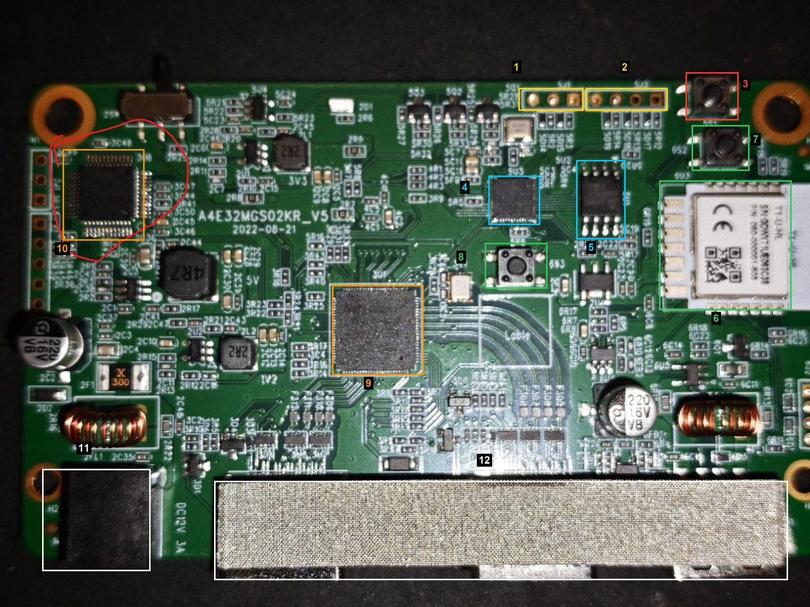
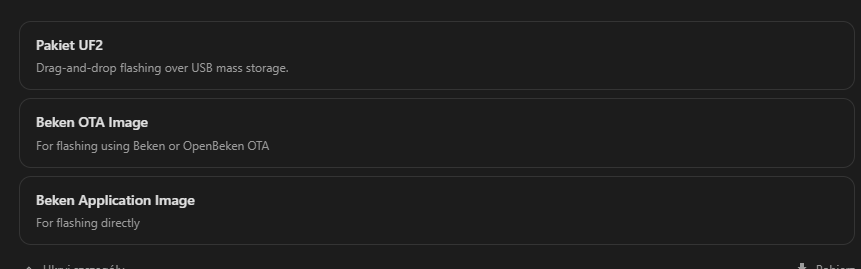
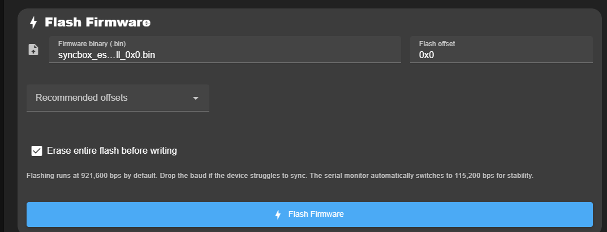
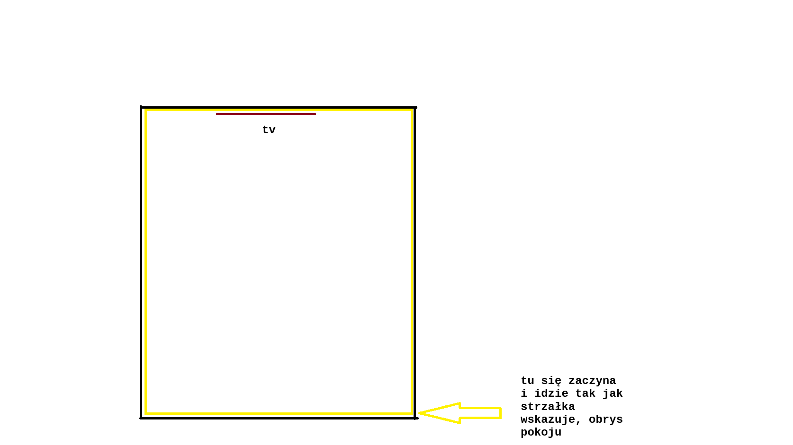

# HDMI Sync Box (Action / Eurodomest, 2nd gen) — ESPHome + custom ESP32 firmware

**English** | [Polski](README.pl.md)

Open firmware for the "HDMI Sync Box" ambilight kit sold by Action (Eurodomest / LSC brand, article 3225765,
PCB `A4E32MGS02KR_V5`). It replaces both factory firmwares in the box:

- **Wi-Fi module (Tuya T1-U, BK7238)** → ESPHome with a custom `syncbox` external component. The box becomes a
  local Home Assistant light with effects, calibration sliders, E1.31/WLED input and E1.31 output to other lamps.
- **Video coprocessor (ESP32-D0WD-V3)** → a firmware written from scratch (ESP-IDF) that samples the analog RGB
  picture and sends a 48×27 colour field to the BK7238 60 times per second.

The factory firmware updates the strip 10–12 times per second. With both firmwares from this repository the strip
follows the picture at the source frame rate (60 fps measured), without the Tuya cloud.

> **Status:** works on one reference unit (2nd generation, PCB dated 2022-08-21). Nothing here was tested on
> another unit or on the 1st generation — see [Will it work on the 1st generation?](#will-it-work-on-the-1st-generation).
> You flash at your own risk; make backups first.

Code comments and the detailed development notes are in Polish. This README and its Polish twin are the
entry point.

## Contents

- [How the box works](#how-the-box-works)
- [How the ESP32 sends video to the BK7238](#how-the-esp32-sends-video-to-the-bk7238)
- [Repository layout](#repository-layout)
- [What you need](#what-you-need)
- [PCB: where to connect and what to press](#pcb-where-to-connect-and-what-to-press)
- [Step 1 — back up both chips](#step-1--back-up-both-chips)
- [Step 2 — ESPHome on the BK7238](#step-2--esphome-on-the-bk7238)
- [Step 3 — custom firmware on the ESP32](#step-3--custom-firmware-on-the-esp32)
- [Step 4 — first start and checks](#step-4--first-start-and-checks)
- [Without the cable: status, console and updates over Wi-Fi](#without-the-cable-status-console-and-updates-over-wi-fi)
- [HDMI drop-outs](#hdmi-drop-outs)
- [HDR](#hdr)
- [Calibration](#calibration)
- [Other lamps in the room (satellites)](#other-lamps-in-the-room-satellites)
- [Will it work on the 1st generation?](#will-it-work-on-the-1st-generation)
- [Known limitations](#known-limitations)
- [Sources](#sources)
- [License](#license)

## How the box works

```
HDMI in ─► GSV2002 (HDMI repeater) ─► HDMI out to the TV
                 │
                 └─► MX9291 (HDMI → analog RGB, 1080p timing) ─► R, G, B + HSync, VSync
                                                                      │
        ESP32-D0WD-V3: ADC1 on GPIO35/32/33, HSync GPIO39, VSync GPIO34
        builds a 48×27 RGB field per frame ─► SPI master, 8 MHz (GPIO4 SCLK, 5 CS, 27 MOSI, 16 MISO)
                                                                      │
        T1-U (BK7238): SPI slave on P14–P17 ─► maps the field to 28 strip sections
        (7 left, 14 top, 7 right) ─► strip data on P0 (UART2, 6.5 Mbaud, 6N1, inverted on the board)
        P24 = strip power enable (active low), P26 = button
```

A small MCU of the HDMI section (HK32) sends a text log with the input timing and HDR mode to the ESP32
(GPIO25, 9600 baud); the firmware uses it to detect HDR and to report the input format.

The same SPI link also carries the HDMI status to the Wi-Fi module and, on the return line, the ESP32 console —
see [Without the cable](#without-the-cable-status-console-and-updates-over-wi-fi).

The strip has 84 LEDs in 28 addressable sections, colour order BRG.

## How the ESP32 sends video to the BK7238

The ESP32 never sends the picture itself, only a small colour field: 48 × 27 cells, three bytes each, once per
source frame. The link is plain SPI with one transfer per frame.

**Wiring and timing.** The ESP32 is the master (SCLK GPIO4, CS GPIO5, MOSI GPIO27, MISO GPIO16), the BK7238 the
slave (P14 SCK, P15 CS, P16 MOSI, P17 MISO). Mode 0, most significant bit first, 8 MHz (`set spi_hz`, 1–20 MHz).
The ESP32 samples the picture while a frame is on screen; at the end of the frame it finishes the field (blur,
smoothing, levels, HDR conversion) and sends it, so there is one transfer per source frame, 60 per second with a
60 Hz source. CS stays low for the whole transfer. A full frame takes 4.4 ms at 8 MHz, and the ESP32 leaves at
least 0.6 ms between transfers so that the slave can re-arm its DMA receive.

**Frame layout** (4416 bytes with the 48 × 27 field: 16 + 3888 + 512; this is `frame_size` in the YAML):

| Offset | Bytes | Content |
|---|---|---|
| 0 | 4 | `SBG2` |
| 4 | 2 | field width W and height H in cells |
| 6 | 2 | W and H inverted bit by bit (a second check of the header) |
| 8 | 1 | frame counter |
| 9 | 2 | sum of all field bytes, 16 bits, low byte first |
| 11 | 1 | flags; bit 0 = the sum is present |
| 12 | 4 | `5A A5 C3 3C` |
| 16 | W × H × 3 | the field: rows from the top, cells from the left, R, G, B, one byte each |
| 16 + W × H × 3 | 512 | status block `SBX1`: HDMI input state and format, HDR mode, drop-out counters, firmware version, console output, CRC16 |

The field size travels in every header, so it can be changed on the ESP32 (`set grid_w`, `set grid_h`) without
touching the BK7238 configuration. Without a video signal the ESP32 sends a frame without a field (W = H = 0,
1128 bytes) that carries only the status block: five times a second, or every 16 ms while a console client is
connected.

**Receiving.** A thread on the BK7238 waits in a DMA receive for `frame_size` bytes or the rising edge of CS. A frame
is used only if the marker bytes, the inverted sizes and the byte sum agree; otherwise it is dropped and counted
(`częściowe` and `błędne` in the log line `klatki:`), and the strip keeps its colours until the next frame. This
thread runs above the Wi-Fi tasks: it has about 12 ms between frames to re-arm the receive, and when it ran below
them every Wi-Fi transmission could cost a frame. The main loop then maps the field to the 28 strip sections
(see [Calibration](#calibration)).

**Return direction.** During the same transfer the BK7238 can answer on MISO. It does so only while a client is
connected to the console port: a block `SBD1` with up to 1024 bytes of console input (commands, or a firmware
image during an update). Both directions send one portion at a time and repeat it in every frame until the other
side acknowledges its number. The exact format of both blocks is in [`esp32/main/link.h`](esp32/main/link.h).

## Repository layout

| Path | What it is |
|---|---|
| [`esphome/hdmi-syncbox.yaml`](esphome/hdmi-syncbox.yaml) | ESPHome configuration for the BK7238 (no secrets; uses `!secret`) |
| [`esphome/secrets.yaml.example`](esphome/secrets.yaml.example) | list of secrets the configuration expects |
| [`esphome/components/syncbox/`](esphome/components/syncbox/) | the external component (strip driver, SPI receiver, mapping, calibration, satellites) and its notes (Polish) |
| [`esphome/diagnostics/`](esphome/diagnostics/) | small configs used to find the strip pins; useful when porting to another board revision |
| [`esp32/`](esp32/) | ESP32 firmware source (ESP-IDF 5.3.1 through PlatformIO) and development notes (Polish) |
| [`firmware/esp32/`](firmware/esp32/) | prebuilt ESP32 firmware v14.7: application and full image, with SHA-256 sums |
| [`tools/bench/`](tools/bench/) | test page and measurement scripts used for calibration and regression tests |
| [`tools/uf2_to_obk.py`](tools/uf2_to_obk.py) | converts an ESPHome UF2 into a raw image for the OpenBeken flasher |
| [`docs/`](docs/) | photos, reference calibration values, research notes on the video path (Polish) |

There is no prebuilt BK7238 firmware: an ESPHome image contains your Wi-Fi password and API key, so you build it
yourself.

## What you need

- A 3.3 V USB-UART adapter and three wires (GND, TX, RX). Soldering is needed for the ESP32 header (`5J1`) and the
  Wi-Fi module pads.
- A PC with Python 3 and [`esptool`](https://github.com/espressif/esptool) (`pip install esptool`).
- [BK7231GUIFlashTool](https://github.com/openshwprojects/BK7231GUIFlashTool) (Windows) for the BK7238.
- ESPHome 2026.10 or newer (the Home Assistant add-on or the command line).
- The box powered from its own 12 V supply while flashing. Connect only GND, TX and RX of the adapter; do not
  feed 3.3 V from the adapter.

## PCB: where to connect and what to press



| No. | Part | Notes |
|---|---|---|
| 1 | `5J1` (3 pads) | **ESP32 UART: RX, TX, GND.** This is the header for flashing the ESP32 and for its console. It has no 3.3 V pad; 3.3 V is available next to the Wi-Fi module. The order of the three pads is not printed: find GND with a continuity test to an HDMI shield; the other two are TX and RX (no text at 115200 baud → swap them). |
| 2 | `5J2` (4 pads) | header of the authorisation circuit (the factory ESP32 firmware talks to it at start-up). Not used by this firmware; leave it alone. |
| 3 | `5S1` button | ESP32 GPIO0. Hold it while resetting or powering up to enter the ESP32 bootloader. |
| 4 | `5U3` | ESP32-D0WD-V3 |
| 5 | `5U1` | ESP32 flash (4 MB) |
| 6 | `6U3` | T1-U-HL Wi-Fi module (BK7238). UART1 for flashing and logs: TX1 = P11, RX1 = P10 (see the T1-U pinout in [Sources](#sources)). |
| 7, 8 | `6S2`, `6S3` buttons | buttons of the Wi-Fi module section. On the 1st generation one of them is the module reset (CEN) and the other a user button; on this unit the user button is read on P26. Which is which was not checked on this board — measure before relying on it. A power cycle works as a reset too. |
| 9 | large chip next to the HDMI ports | GSV2002 HDMI repeater |
| 10 | `3U8` (circled in red on the photo) | MCU of the HDMI section (HK32). This footprint is reported as unpopulated on the 1st generation. |
| 11 | DC jack | 12 V, 3 A |
| 12 | HDMI ports | |

The MX9291 video converter is not marked: its position was not identified from this photo.
The unmarked photo is in [`docs/img/pcb-top.jpg`](docs/img/pcb-top.jpg). Photos of the 1st generation, including
the bottom side and the case, are in the elektroda teardown linked in [Sources](#sources).

## Step 1 — back up both chips

Do this before writing anything. The backups are the only way back to the factory firmware.

**BK7238:** BK7231GUIFlashTool → chip type `BK7238` → select the COM port → *Do backup and flash new* or
*Do firmware backup (read) only*. When the tool prints "Getting bus…", reset the module (power cycle the box or
short CEN to GND for a moment). Keep the resulting `readResult_BK7238_QIO_*.bin`.

**ESP32:** hold `5S1`, power cycle (or reset), release, then:

```bash
esptool --chip esp32 -p COM4 -b 460800 read-flash 0 0x400000 esp32_factory_backup.bin
```

Do not publish your backups: they contain the vendor's firmware and device-specific data.

## Step 2 — ESPHome on the BK7238

1. Copy [`esphome/hdmi-syncbox.yaml`](esphome/hdmi-syncbox.yaml) and the [`esphome/components`](esphome/components)
   folder into your ESPHome configuration folder (in Home Assistant: `/config/esphome/`).
2. Create `secrets.yaml` from [`secrets.yaml.example`](esphome/secrets.yaml.example).
3. Adjust `layout:` if your strip is mounted differently (see [Calibration](#calibration)).
4. Build. In the ESPHome dashboard choose *Install → Manual download*.



**First flash over UART.** What worked on the reference unit:

1. The factory (Tuya) bootloader of this module did not start ESPHome images written over UART. Flashing
   OpenBeken once with BK7231GUIFlashTool (*Download latest from Web*, then *Do firmware write*) replaces it with
   the standard Beken bootloader.
2. Download the **Beken Application Image** (`image_bk7238_app.0x011000.rbl`) from ESPHome and write it with
   BK7231GUIFlashTool at **offset 0x11000** (custom write; the tool computes the sector count). Never write this
   file at 0x0.
3. The configuration uses `board: generic-bk7238` on purpose: with this layout ESPHome sends OTA updates in the
   format the standard bootloader understands. With `board: t1-u` the OTA showed progress but the new image was
   never installed.

`ltchiptool flash write firmware.uf2` also works in principle, but on this chip it caught the bootloader only
about one time in ten. [`tools/uf2_to_obk.py`](tools/uf2_to_obk.py) turns a UF2 into a raw image for offset
0x11000 if you only have the UF2.

After the first flash all further updates go over Wi-Fi (ESPHome OTA). Logs go over the network. The example config
keeps the serial output off (`baud_rate: 0`): at 115200 baud every log line blocks the main loop, the once-per-second
statistics line for 16–22 ms, which is longer than a video frame. Set 115200 only while you debug with a UART
adapter. P0 (UART2) belongs to the strip, so do not move the logger there.

## Step 3 — custom firmware on the ESP32

Enter the bootloader (hold `5S1`, power cycle, release) and write the full image at offset 0:

```bash
esptool --chip esp32 -p COM4 -b 460800 write-flash 0x0 firmware/esp32/syncbox_esp32_v14.7_full_0x0.bin
```

Any esptool-based flasher works; in a browser flasher set the offset to `0x0`:



The image contains its own bootloader, partition table (two OTA slots) and the application. Power cycle the box
afterwards.

**Later updates need no button and no cable** (see the Wi-Fi section below). Over UART: the firmware has a console
on the same header (115200 8N1). The `upload` command
takes a new application over the console, writes it to the inactive OTA slot and restarts:

```bash
python esp32/esp32_upload.py COM4 firmware/esp32/syncbox_esp32_v14.7_app_0x20000.bin
```

**Building from source:**

```bash
cd esp32
pio run
```

The result is `.pio/build/syncbox/firmware.bin`. The project uses `espressif32@6.9.0` (ESP-IDF 5.3.1).

## Step 4 — first start and checks

Open a serial terminal on the ESP32 header `5J1` (115200 8N1) and type `help`. The commands used most:

| Command | What it shows or does |
|---|---|
| `stat` | sync frequency, detected format, frames processed, raw ADC codes, SPI frame rate |
| `pattern 1` / `pattern 2` / `pattern 0` | rainbow / side bars (left red, top green, right blue) / live video |
| `ascii`, `grid` | the last colour field as characters or hex |
| `params`, `set <name> <value>`, `save`, `defaults` | tuning without recompiling; `save` stores to flash |
| `hdmi` | last text received from the HDMI section and the HDR mode |
| `trace [n]` | centre colour over n consecutive frames (for latency tests) |

Checks, in this order:

1. `pattern 1`: the strip shows a moving rainbow and Home Assistant shows "FPS wideo" near 60. This proves the
   SPI link and the BK7238 side.
2. `pattern 2`: red must be on the left edge of the TV, green on top, blue on the right (seen from the front).
   If not, fix `start_corner` / `direction` in the YAML.
3. `pattern 0` with an HDMI source: `stat` should show VSync 60 Hz, format 1080p and 0 empty cells.
4. In Home Assistant turn on the light and select the effect "Synchronizacja HDMI".

Entity names in the example configuration are in Polish ("Wideo: gamma", "FPS wideo", …); rename them in the YAML
if you prefer.

## Without the cable: status, console and updates over Wi-Fi

After the first flash the UART adapter is not needed any more (ESP32 firmware v14.4+, component v17+). The SPI
link between the two chips carries more than the picture:

- **HDMI status in Home Assistant.** `hdmi_input` shows the input format and HDR mode as text
  (`3840x2160P60 HDR10`, or "brak sygnału" when there is no signal) and `hdmi_dropouts` counts signal losses at the
  input. Every change is also written to the ESPHome log.
- **ESP32 console over the network.** With `esp32_console:` in the YAML the box opens a TCP port (2323). All
  console commands work through it, and the tools accept `tcp://<box-address>:2323` in place of `COM4`:

  ```bash
  set SYNCBOX_CONSOLE_PASSWORD=your-console-password
  python tools/bench/espcmd.py tcp://192.168.1.50:2323 "ver ; stat ; hdmi log"
  ```

- **ESP32 firmware updates over Wi-Fi:**

  ```bash
  python esp32/esp32_upload.py tcp://192.168.1.50:2323 firmware/esp32/syncbox_esp32_v14.7_app_0x20000.bin
  ```

  The uploaded firmware starts on trial. It is kept only if the link to the Wi-Fi module works after the restart;
  otherwise the ESP32 returns to the previous version by itself after 120 s. The script stays connected and prints
  the confirmation. A firmware that restarts four times in a row without 30 s of normal work is also rolled back.
  `ver` prints the reason of the last start and a history of the last six starts, so a failed update can be
  explained afterwards.

Set a console password. Without one, anybody on the local network can control the ESP32 and upload firmware to it.

Measured on the reference unit: a connected but idle client does not change the picture (59.9 fps, 117 strip
writes/s); a firmware upload of 382 kB takes 19 s including the restart; heavy console output costs about one
frame per second while it runs.

The return line from the Wi-Fi module (its MISO pin, P17) arrives at **GPIO16** of the ESP32 on this board. The
factory configuration names GPIO19, where nothing is connected; `link scan` in the ESP32 console shows which pins
are driven by another chip.

## HDMI drop-outs

If the picture on the TV blinks or the link seems to reconnect, `hdmi log` (or `tools/bench/hdmilog.py`) shows what
the HDMI section saw at that moment: a format or HDR change by the source, `NO SIGNAL` at the input, or nothing at
all on the input side. On the reference unit a 5 m cable between a streaming box and the sync box caused about one
drop-out every 9 minutes with 4K60 HDR; with a short cable there were none in 40 minutes. The same 5 m cable worked
straight into the TV, so keep the cables on both sides of the box short.

## HDR

With an HDR10 or HDR10+ source the analog path delivers the signal values as they are: PQ-coded (SMPTE ST 2084), in
BT.2020 primaries. Read as ordinary video they give flat, shifted colours — red turns orange, green turns yellow,
warm tones drift towards yellow-green. From v14.5 the ESP32 converts them: PQ → linear light → BT.2020 to BT.709 →
sRGB, with `hdr_white` nits (default 203) mapped to full output. Brighter colours are dimmed as a whole, so the hue
stays.

Measured on the reference unit with `tools/bench/hdrtest.py` (4K60 HDR10 from a PC, RGB output; 16 sRGB colours
shown in HDR with white at 203 nits):

| | saturation gain only (up to v14.4) | conversion (v14.5) |
|---|---|---|
| mean hue error | 13.2° | 1.2° |
| largest hue error | 32° (green) | 3° |
| white 255 255 255 reads as | 148 149 149 | 249 251 251 |
| dark grey 64 reads as | 77 | 64–65 |

- `set hdr_conv 0` returns to the old method. `set hdr_white <nits>` moves the picture brightness at which the strip
  reaches full power (a lower value makes the strip brighter). `save` keeps the setting.
- HLG and Dolby Vision still use the saturation gain (`hdr_gain`).
- The measurement used RGB output from a PC. Players that send YCbCr also pass through the colour conversion of the
  HDMI chip in the box, which was not measured.

The tester runs on Windows: `python tools/bench/hdrtest.py tcp://<box-address>:2323 <display number>`. It opens its
own full-screen HDR10 window on the display fed through the box (HDR has to be enabled for that display in Windows),
shows patches with exact signal values and compares them with what the ESP32 reads.
`python tools/bench/hdrtest.py info` lists the displays.

## Calibration

The picture reaches the ESP32 as analog voltages, so levels and timing are properties of the board. The defaults
compiled into the firmware are the values measured on the reference unit; they are listed in
[`docs/calibration-esp32-params.txt`](docs/calibration-esp32-params.txt). Start with them and recalibrate only
what looks wrong.

### ESP32 (console)

| What | Parameters (reference values) | How to check |
|---|---|---|
| Black and white level | `black_mv` 584, `white_mv` 1408; for the second ADC range `black2_mv` 398, `white2_mv` 991 | full-screen black and white: `stat` prints the mean ADC codes. `tools/bench/calib.py COM4` does it automatically with the test page. |
| Horizontal position and width | `hoff` 0, `hblank` 127 (12.7 % for 1080p) | a pattern with vertical colour bars, then `ascii` / `grid` |
| Sample timing | `dig_d` 686 (ns) | `tools/bench/bleed.py`: a red frame with a green interior; green leaking in on the left means `dig_d` too small, on the right too large |
| Black bars | `lbox` 1, `lbox_thr` 12 | `tools/bench/letterbox.py` |
| Field size and blur | `grid_w` 48, `grid_h` 27, `blur` 5, `blur_in` 80 | |
| Temporal filter | `smooth` 4, `smooth_t1` 10, `smooth_tc` 25, `smooth_t2` 32, `smooth_nz` 30, `hold` 10 | `tools/bench/stability.py`, `latency.py`, `edgedetail.py` |
| HDR | `hdr_mode` 0 (auto), `hdr_conv` 1, `hdr_white` 203; `hdr_gain` 200 for HLG / Dolby Vision | `tools/bench/hdrtest.py`; `hdmi` shows the detected mode |

Finish with `save`. `defaults` restores the compiled-in values (without saving). What each filter parameter
does, with measurements, is described in [`esp32/README.md`](esp32/README.md) (Polish).

The test bench: run `python tools/bench/server.py 8765` on a PC, open `http://<pc-address>:8765` full screen on a
display fed through the box, and run the scripts in `tools/bench/` with the ESP32 console port as the argument.

### ESPHome (Home Assistant sliders)

The colour chain on the BK7238 is: mean of the edge cells (`depth`) → black/white level → white balance → gamma
→ saturation → inner mix and centre dimming → brightness → smoothing → temporal dithering.

1. **Strip geometry** (YAML `layout:`): number of sections per side, `start_corner`, `direction`. The reference
   mounting, seen from the back of the TV:

   

2. **White balance:** show a white screen and adjust "Wideo: balans R/G/B" until the strip is neutral
   (a bluish white → lower B).
3. **Black level:** show a black screen and raise "Wideo: poziom czerni" until the strip goes dark.
4. **Gamma and saturation:** on normal content. Higher gamma deepens contrast; saturation above 1 makes colours
   stronger.
5. **Sampling depth and side offsets:** "Wideo: głębokość próbkowania" sets how many cells from the edge are
   averaged (1 = a narrow band, livelier colours); "Kalibracja: odstęp … bok" skips cells at the edge.
6. **Smoothing:** "Wideo: wygładzanie" (0 = none). The ESP32 already filters noise, so small values are enough.
7. **Inner mix:** "Wideo: doświetlenie ze środka" (0–40 %) adds light from deeper in the picture when the edge is
   much darker than the interior.
8. **Centre dimming:** "Wideo: przygaszanie przy ciemnym środku" (0–100 %, off in the example config) is the
   opposite case: when the interior is darker than the edge, the section loses that share of the difference in
   brightness, keeping the edge colour. Use it if a bright, contrasty edge lights the strip up while the rest
   of the screen is dark; try a larger sampling depth first.

Values used on the reference unit: gamma 2.6, saturation 1.2–1.8, smoothing 0.3, white balance 1.0 / 1.0 / 1.0,
side offsets 1, inner mix 25 %. Sliders are stored in flash and survive updates.

## Other lamps in the room (satellites)

The box can send colours to other lights over E1.31 (sACN): WLED, ESPHome lights with the `e131` effect, DMX
gateways. Each entry in `satellites:` is one receiver. Modes: one colour (`average`, `left`, `top`, `right`,
`bottom`), a copy of the strip (`mirror`), the whole field (`full`) or `room` — the screen edge colours laid out
along a strip that runs around the room:



Per satellite you set the update rate, a transition time, blur along the strip and the receiver's gamma
(ESPHome lights apply gamma 2.8 to received values; without compensation every change is exaggerated). A complete
example is in [`esphome/hdmi-syncbox.yaml`](esphome/hdmi-syncbox.yaml); details and measurements are in the
component notes, section v16.

## Will it work on the 1st generation?

Possibly, but it is untested.

- The PCB has the same name (`A4E32MGS02KR`) and, according to the owner of the reference unit, the same layout
  and markings. The ESP32 pins used here match the configuration printed in the 1st-generation boot log
  (ADC 35/32/33, sync 39/34, SPI 19/27/4/5), so the **ESP32 firmware is likely to run**. The 1st generation
  uses a different video converter (CS5210 instead of MX9291), so expect to recalibrate levels and timing.
- The 1st generation has a CBU module (BK7231N) instead of T1-U (BK7238). The `syncbox` component uses the
  BK7238 SPI slave with DMA and was only built for `generic-bk7238`. Community reports for the 1st generation
  describe the strip data on P0 through a NOR gate with P8, not the P0 + P24 arrangement found here. The
  **ESPHome part therefore needs porting and testing**; the configs in `esphome/diagnostics/` were made for
  finding these pins.

If you try it, please report what you find.

## Known limitations

- Tested on a single unit, with 1080p60 and 4K60 sources. The HDR10 conversion was measured with RGB output from
  a PC only; YCbCr HDR sources, HLG and Dolby Vision were not measured.
- The picture is sampled from a 1080p analog signal with about 14 000 samples per frame, so very fine,
  high-contrast detail at the edge is noisy by nature; the temporal filter hides it at the cost of slower
  response of single cells.
- Satellites take main-loop time on the BK7238 (about 2.3 ms per packet): with two lamps the strip gets about
  117 writes per second instead of 119, and about one video frame in 800 is processed late.
- No microphone / music mode.
- After a software restart the ESP32's ADC controller sometimes delivers no samples (2 of 11 starts in one
  series, none in the next 23). The firmware detects it at start and does a full chip reset, which makes that
  start about 2 s longer. Why the controller stalls is not established.
- End-to-end latency was estimated from its parts (about 14 ms from the end of a frame to the strip), not
  measured from screen to LED.

## Sources

Hardware and prior work:

- [Teardown of the 1st-generation box, with boot logs of both chips (elektroda.com, user Dark Man)](https://www.elektroda.com/news/news4090571.html) — the photos of the 1st generation are there
- [OpenBeken on the Smart HDMI Sync Box 6204000100 (elektroda.com)](https://www.elektroda.com/rtvforum/topic4123137.html)
- [T1-U-HL as a CBU replacement, pinout (elektroda.pl, in Polish)](https://www.elektroda.pl/rtvforum/topic4157516.html)
- [T1 module family, BK7238 pinout and datasheet (elektroda.com)](https://www.elektroda.com/news/news4132679.html)
- [ESPHome firmware collection for Action devices, including this box, by seb5594](https://github.com/seb5594/Action_Battleton_Eurodomest_LSC-Smart-Custom-Firmware-Collection)
- [GSV2002 specification](https://www.onwaytech.com/static/upload/file/20231031/1698717765932698.pdf)
- [CS5210 datasheet (the 1st-generation video converter)](https://file.elecfans.com/web2/M00/06/52/poYBAGDmW5KAJvWbAAfHWgYZXlU522.pdf)

Tools and platforms:

- [ESPHome](https://esphome.io/) and [LibreTiny](https://docs.libretiny.eu/)
- [BK7231GUIFlashTool (OpenBeken flasher)](https://github.com/openshwprojects/BK7231GUIFlashTool)
- [esptool](https://github.com/espressif/esptool), [PlatformIO](https://platformio.org/)
- [ESP32 Technical Reference Manual (SAR ADC, I2S)](https://documentation.espressif.com/esp32_technical_reference_manual_en.pdf)
- [esp-idf issue on the I2S FIFO registers used for fast ADC sampling](https://github.com/espressif/esp-idf/issues/8862)

Behaviour of room lights:

- [HAmbiSync notes on how Ambilight+hue maps lamps and transitions](https://amip.tools-for.net/wiki/_export/raw/misc/hambisync)
- [Signify press release on Hue Sync intensity levels](https://www.signify.com/en-us/about/news/press-releases/2018/20180531-create-surround-sound-for-your-eyes-with-philips-hue-sync)

More references are in [`docs/video-path-research.pl.md`](docs/video-path-research.pl.md).

## License

[MIT](LICENSE). ESPHome and LibreTiny, which the BK7238 firmware is built with, have their own licences.

## Disclaimer

This is a hobby project, not affiliated with Action, Eurodomest, LSC, Tuya or any chip vendor. Opening the box
and replacing its firmware voids the warranty and can break the device. The box runs on 12 V DC; never work on
it while it is connected to anything else.
