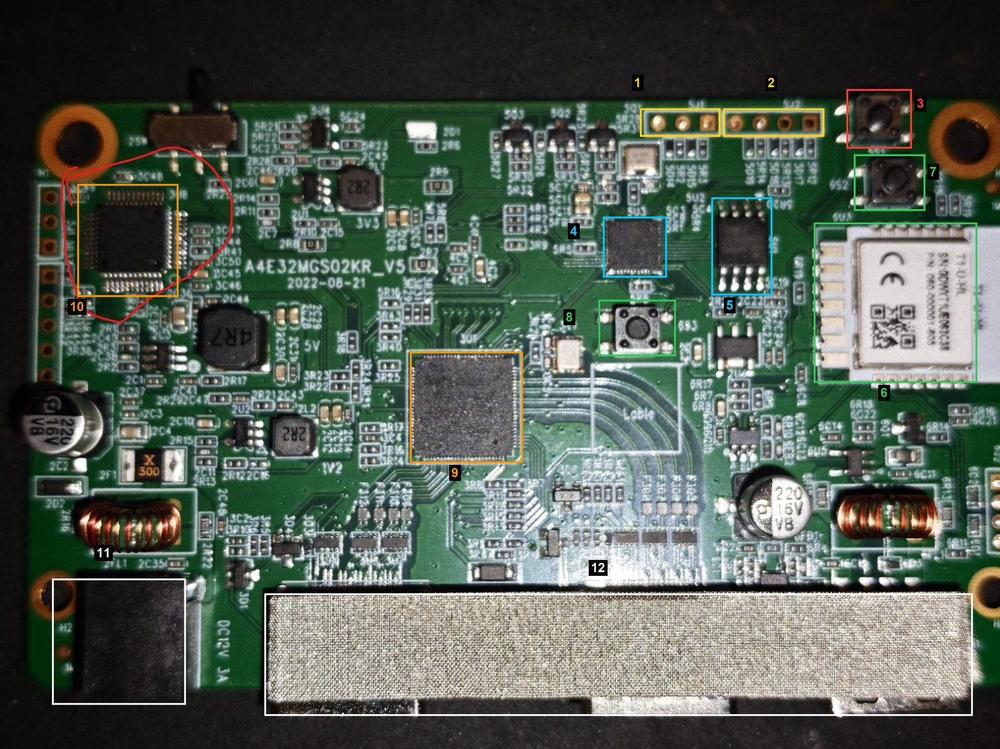
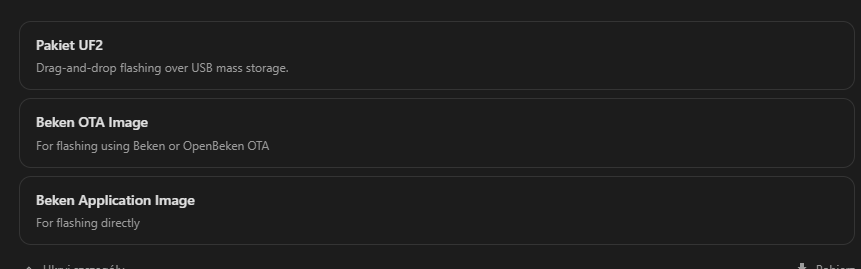
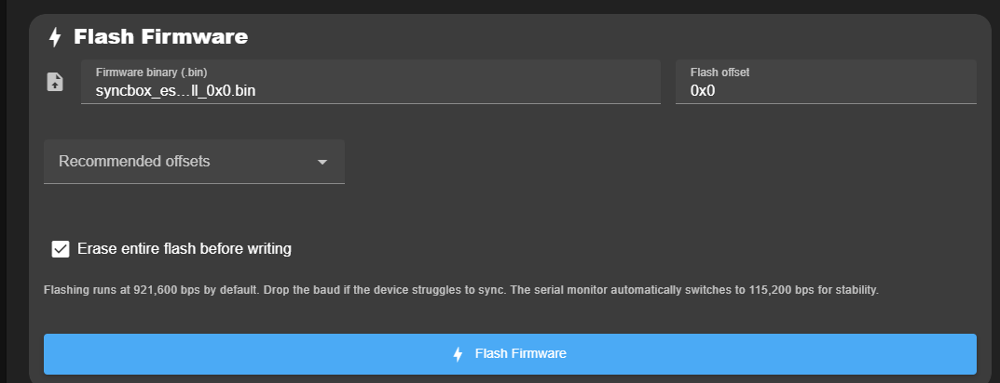
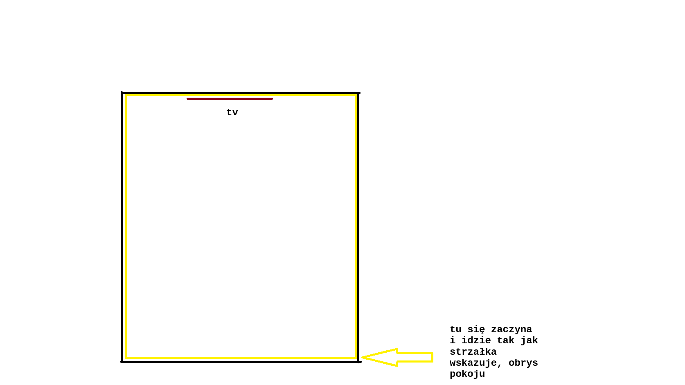

# HDMI Sync Box (Action / Eurodomest, 2. generacja) — ESPHome i własny firmware ESP32

[English](README.md) | **Polski**

Otwarty firmware do zestawu ambilight „HDMI Sync Box” z Action (marka Eurodomest / LSC, artykuł 3225765,
płytka `A4E32MGS02KR_V5`). Zastępuje oba fabryczne firmware'y w boxie:

- **Moduł Wi-Fi (Tuya T1-U, BK7238)** → ESPHome z własnym komponentem zewnętrznym `syncbox`. Box staje się
  lokalnym światłem w Home Assistant: efekty, suwaki kalibracji, wejście E1.31/WLED i wyjście E1.31 do innych lamp.
- **Koprocesor wideo (ESP32-D0WD-V3)** → firmware napisany od zera (ESP-IDF), który próbkuje analogowy obraz RGB
  i 60 razy na sekundę wysyła do BK7238 pole kolorów 48×27.

Fabryczny firmware odświeża taśmę 10–12 razy na sekundę. Z oboma firmware'ami z tego repozytorium taśma idzie
za obrazem w tempie źródła (zmierzone 60 kl./s), bez chmury Tuya.

> **Stan:** działa na jednym egzemplarzu wzorcowym (2. generacja, płytka z datą 2022-08-21). Nic stąd nie było
> sprawdzane na innym egzemplarzu ani na 1. generacji — patrz [Czy zadziała na 1. generacji?](#czy-zadziała-na-1-generacji).
> Wgrywasz na własne ryzyko; najpierw zrób kopie.

Komentarze w kodzie i szczegółowe notatki z rozwoju są po polsku. Punktem wejścia jest ten plik i jego
angielski odpowiednik.

## Spis treści

- [Jak działa box](#jak-działa-box)
- [Jak ESP32 wysyła wideo do BK7238](#jak-esp32-wysyła-wideo-do-bk7238)
- [Układ repozytorium](#układ-repozytorium)
- [Co jest potrzebne](#co-jest-potrzebne)
- [Płytka: gdzie się podłączyć i co nacisnąć](#płytka-gdzie-się-podłączyć-i-co-nacisnąć)
- [Krok 1 — kopie obu układów](#krok-1--kopie-obu-układów)
- [Krok 2 — ESPHome na BK7238](#krok-2--esphome-na-bk7238)
- [Krok 3 — własny firmware na ESP32](#krok-3--własny-firmware-na-esp32)
- [Krok 4 — pierwsze uruchomienie i testy](#krok-4--pierwsze-uruchomienie-i-testy)
- [Bez kabla: stan, konsola i aktualizacje przez Wi-Fi](#bez-kabla-stan-konsola-i-aktualizacje-przez-wi-fi)
- [Zaniki obrazu HDMI](#zaniki-obrazu-hdmi)
- [HDR](#hdr)
- [Kalibracja](#kalibracja)
- [Inne lampy w pokoju (satelity)](#inne-lampy-w-pokoju-satelity)
- [Czy zadziała na 1. generacji?](#czy-zadziała-na-1-generacji)
- [Znane ograniczenia](#znane-ograniczenia)
- [Źródła](#źródła)
- [Licencja](#licencja)

## Jak działa box

```
wejście HDMI ─► GSV2002 (repeater HDMI) ─► wyjście HDMI do TV
                     │
                     └─► MX9291 (HDMI → analogowe RGB, timing 1080p) ─► R, G, B + HSync, VSync
                                                                          │
        ESP32-D0WD-V3: ADC1 na GPIO35/32/33, HSync GPIO39, VSync GPIO34
        składa pole 48×27 RGB na klatkę ─► SPI master, 8 MHz (GPIO4 SCLK, 5 CS, 27 MOSI, 16 MISO)
                                                                          │
        T1-U (BK7238): SPI slave na P14–P17 ─► rozkłada pole na 28 sekcji taśmy
        (7 z lewej, 14 u góry, 7 z prawej) ─► dane taśmy na P0 (UART2, 6,5 Mbaud, 6N1, odwracane na płytce)
        P24 = załączenie zasilania taśmy (aktywne nisko), P26 = przycisk
```

Mały mikrokontroler części HDMI (HK32) wysyła do ESP32 (GPIO25, 9600 bodów) tekstowy log z formatem wejścia
i trybem HDR; firmware rozpoznaje z niego HDR i format wejścia.

To samo łącze SPI niesie też stan HDMI do modułu Wi-Fi, a linią zwrotną konsolę ESP32 —
patrz [Bez kabla](#bez-kabla-stan-konsola-i-aktualizacje-przez-wi-fi).

Taśma ma 84 diody w 28 adresowalnych sekcjach, kolejność kolorów BRG.

## Jak ESP32 wysyła wideo do BK7238

ESP32 nie wysyła samego obrazu, tylko małe pole kolorów: 48 × 27 komórek po trzy bajty, raz na klatkę źródła.
Łącze to zwykłe SPI, jedna transmisja na klatkę.

**Połączenie i czasy.** ESP32 jest masterem (SCLK GPIO4, CS GPIO5, MOSI GPIO27, MISO GPIO16), BK7238 slave'em
(P14 SCK, P15 CS, P16 MOSI, P17 MISO). Tryb 0, najstarszy bit pierwszy, 8 MHz (`set spi_hz`, 1–20 MHz). ESP32
próbkuje obraz, gdy klatka jest na ekranie; po jej końcu domyka pole (rozmycie, wygładzanie, poziomy, konwersja
HDR) i je wysyła, więc na każdą klatkę źródła przypada jedna transmisja — 60 na sekundę przy źródle 60 Hz. CS jest
nisko przez całą transmisję. Pełna ramka trwa 4,4 ms przy 8 MHz, a ESP32 zostawia między transmisjami co najmniej
0,6 ms, żeby slave zdążył ponownie uzbroić odbiór DMA.

**Układ ramki** (4416 bajtów przy polu 48 × 27: 16 + 3888 + 512; to `frame_size` w YAML):

| Pozycja | Bajtów | Zawartość |
|---|---|---|
| 0 | 4 | `SBG2` |
| 4 | 2 | szerokość W i wysokość H pola w komórkach |
| 6 | 2 | W i H z odwróconymi bitami (druga kontrola nagłówka) |
| 8 | 1 | licznik ramek |
| 9 | 2 | suma wszystkich bajtów pola, 16 bitów, młodszy bajt pierwszy |
| 11 | 1 | flagi; bit 0 = suma jest obecna |
| 12 | 4 | `5A A5 C3 3C` |
| 16 | W × H × 3 | pole: wiersze od góry, komórki od lewej, R, G, B po jednym bajcie |
| 16 + W × H × 3 | 512 | blok stanu `SBX1`: stan i format wejścia HDMI, tryb HDR, liczniki zaników, wersja firmware, wyjście konsoli, CRC16 |

Rozmiar pola jest w każdym nagłówku, więc można go zmienić na ESP32 (`set grid_w`, `set grid_h`) bez ruszania
konfiguracji BK7238. Bez sygnału wideo ESP32 wysyła ramkę bez pola (W = H = 0, 1128 bajtów), która niesie sam
blok stanu: pięć razy na sekundę albo co 16 ms, gdy podłączony jest klient konsoli.

**Odbiór.** Wątek na BK7238 czeka w odbiorze DMA na `frame_size` bajtów albo na narastające zbocze CS. Ramka jest
używana tylko wtedy, gdy zgadzają się bajty znacznika, odwrócone rozmiary i suma bajtów; inaczej jest odrzucana
i liczona (`partial` i `bad` w linii logu `frames:`), a taśma trzyma kolory do następnej ramki. Wątek pracuje
powyżej zadań Wi-Fi: na ponowne uzbrojenie odbioru ma ok. 12 ms między ramkami, a gdy pracował poniżej nich,
każde nadawanie Wi-Fi mogło kosztować klatkę. Pętla główna rozkłada potem pole na 28 sekcji taśmy
(patrz [Kalibracja](#kalibracja)).

**Kierunek zwrotny.** W tej samej transmisji BK7238 może odpowiedzieć linią MISO. Robi to tylko wtedy, gdy do portu
konsoli podłączony jest klient: blok `SBD1` z najwyżej 1024 bajtami wejścia konsoli (komendy albo obraz firmware
podczas aktualizacji). Oba kierunki wysyłają jedną porcję naraz i powtarzają ją w każdej ramce, aż druga strona
potwierdzi jej numer. Dokładny format obu bloków jest w [`esp32/main/link.h`](esp32/main/link.h).

## Układ repozytorium

| Ścieżka | Co to jest |
|---|---|
| [`esphome/hdmi-syncbox.yaml`](esphome/hdmi-syncbox.yaml) | konfiguracja ESPHome dla BK7238 (bez haseł; używa `!secret`) |
| [`esphome/secrets.yaml.example`](esphome/secrets.yaml.example) | lista wpisów `secrets.yaml`, których oczekuje konfiguracja |
| [`esphome/components/syncbox/`](esphome/components/syncbox/) | komponent zewnętrzny (sterownik taśmy, odbiornik SPI, mapowanie, kalibracja, satelity) i jego notatki |
| [`esphome/diagnostics/`](esphome/diagnostics/) | małe konfiguracje, którymi szukane były piny taśmy; przydatne przy przenoszeniu na inną wersję płytki |
| [`esp32/`](esp32/) | źródła firmware ESP32 (ESP-IDF 5.3.1 przez PlatformIO) i notatki z rozwoju |
| [`firmware/esp32/`](firmware/esp32/) | gotowy firmware ESP32 v14.7: aplikacja i pełny obraz, z sumami SHA-256 |
| [`tools/bench/`](tools/bench/) | strona testowa i skrypty pomiarowe do kalibracji i testów regresji |
| [`tools/uf2_to_obk.py`](tools/uf2_to_obk.py) | zamienia UF2 z ESPHome na surowy obraz dla flashera OpenBeken |
| [`docs/`](docs/) | zdjęcia, wzorcowe wartości kalibracji, notatki o torze wideo |

Gotowego firmware dla BK7238 nie ma: obraz ESPHome zawiera hasło Wi-Fi i klucz API, więc każdy buduje go sam.

## Co jest potrzebne

- Adapter USB-UART 3,3 V i trzy przewody (GND, TX, RX). Do złącza ESP32 (`5J1`) i padów modułu Wi-Fi trzeba się dolutować.
- PC z Pythonem 3 i [`esptool`](https://github.com/espressif/esptool) (`pip install esptool`).
- [BK7231GUIFlashTool](https://github.com/openshwprojects/BK7231GUIFlashTool) (Windows) do BK7238.
- ESPHome 2026.10 lub nowsze (dodatek Home Assistant albo wiersz poleceń).
- Box zasilany z własnego zasilacza 12 V na czas wgrywania. Z adaptera podłącz tylko GND, TX i RX; nie podawaj
  3,3 V z adaptera.

## Płytka: gdzie się podłączyć i co nacisnąć



| Nr | Element | Uwagi |
|---|---|---|
| 1 | `5J1` (3 pady) | **UART ESP32: RX, TX, GND.** To złącze do wgrywania ESP32 i do jego konsoli. Nie ma na nim 3,3 V; 3,3 V jest przy module Wi-Fi. Kolejność trzech padów nie jest opisana: GND znajdziesz testem ciągłości do ekranu gniazda HDMI; pozostałe dwa to TX i RX (brak tekstu przy 115200 bodów → zamień je). |
| 2 | `5J2` (4 pady) | złącze układu autoryzacji (fabryczny firmware ESP32 rozmawia z nim przy starcie). Ten firmware go nie używa; zostaw je w spokoju. |
| 3 | przycisk `5S1` | GPIO0 ESP32. Przytrzymany przy resecie lub włączeniu zasilania wprowadza ESP32 w tryb programowania. |
| 4 | `5U3` | ESP32-D0WD-V3 |
| 5 | `5U1` | pamięć flash ESP32 (4 MB) |
| 6 | `6U3` | moduł Wi-Fi T1-U-HL (BK7238). UART1 do wgrywania i logów: TX1 = P11, RX1 = P10 (pinout T1-U w [Źródłach](#źródła)). |
| 7, 8 | przyciski `6S2`, `6S3` | przyciski części modułu Wi-Fi. W 1. generacji jeden z nich to reset modułu (CEN), a drugi przycisk użytkownika; w tym egzemplarzu przycisk użytkownika jest czytany na P26. Który jest który, nie było sprawdzane na tej płytce — zmierz, zanim na tym polegasz. Resetem jest też wyłączenie i włączenie zasilania. |
| 9 | duży układ przy gniazdach HDMI | repeater HDMI GSV2002 |
| 10 | `3U8` (zakreślony na czerwono na zdjęciu) | mikrokontroler części HDMI (HK32). W 1. generacji to miejsce ma być niewlutowane. |
| 11 | gniazdo zasilania | 12 V, 3 A |
| 12 | gniazda HDMI | |

Konwerter wideo MX9291 nie jest zaznaczony: jego położenia nie udało się ustalić z tego zdjęcia.
Zdjęcie bez oznaczeń: [`docs/img/pcb-top.jpg`](docs/img/pcb-top.jpg). Zdjęcia 1. generacji, w tym spodu płytki
i obudowy, są w teardownie na elektrodzie podanym w [Źródłach](#źródła).

## Krok 1 — kopie obu układów

Zrób je, zanim cokolwiek zapiszesz. Kopie to jedyna droga powrotu do fabrycznego firmware.

**BK7238:** BK7231GUIFlashTool → typ układu `BK7238` → wybierz port COM → *Do backup and flash new* albo
*Do firmware backup (read) only*. Gdy program wypisuje „Getting bus…”, zresetuj moduł (wyłącz i włącz zasilanie
boxa albo zewrzyj na chwilę CEN do masy). Zachowaj plik `readResult_BK7238_QIO_*.bin`.

**ESP32:** przytrzymaj `5S1`, wyłącz i włącz zasilanie (albo zresetuj), puść, potem:

```bash
esptool --chip esp32 -p COM4 -b 460800 read-flash 0 0x400000 esp32_factory_backup.bin
```

Nie publikuj swoich kopii: zawierają firmware producenta i dane konkretnego urządzenia.

## Krok 2 — ESPHome na BK7238

1. Skopiuj [`esphome/hdmi-syncbox.yaml`](esphome/hdmi-syncbox.yaml) i katalog
   [`esphome/components`](esphome/components) do katalogu konfiguracji ESPHome (w Home Assistant: `/config/esphome/`).
2. Utwórz `secrets.yaml` według [`secrets.yaml.example`](esphome/secrets.yaml.example).
3. Popraw `layout:`, jeśli taśma jest zamontowana inaczej (patrz [Kalibracja](#kalibracja)).
4. Zbuduj. W panelu ESPHome wybierz *Install → Manual download*.



**Pierwsze wgranie po UART.** Co zadziałało na egzemplarzu wzorcowym:

1. Fabryczny bootloader (Tuya) tego modułu nie uruchamiał obrazów ESPHome wgranych po UART. Jednorazowe wgranie
   OpenBeken programem BK7231GUIFlashTool (*Download latest from Web*, potem *Do firmware write*) zastępuje go
   standardowym bootloaderem Bekena.
2. Pobierz z ESPHome **Beken Application Image** (`image_bk7238_app.0x011000.rbl`) i wgraj go programem
   BK7231GUIFlashTool pod **offset 0x11000** (zapis własny; liczbę sektorów program liczy sam). Nigdy nie wgrywaj
   tego pliku pod 0x0.
3. Konfiguracja celowo ma `board: generic-bk7238`: w tym układzie ESPHome wysyła aktualizacje OTA w formacie,
   który rozumie standardowy bootloader. Przy `board: t1-u` OTA pokazywało postęp, ale nowy obraz nigdy się nie
   instalował.

`ltchiptool flash write firmware.uf2` też w zasadzie działa, ale na tym układzie łapał bootloader mniej więcej
raz na dziesięć prób. [`tools/uf2_to_obk.py`](tools/uf2_to_obk.py) robi z UF2 surowy obraz pod offset 0x11000,
jeśli masz tylko UF2.

Po pierwszym wgraniu wszystkie kolejne aktualizacje idą po Wi-Fi (OTA ESPHome). Logi idą po sieci. Przykładowa
konfiguracja ma wyjście szeregowe wyłączone (`baud_rate: 0`): przy 115200 bodów każda linia logu wstrzymuje pętlę
główną, a linia statystyk raz na sekundę na 16–22 ms, czyli dłużej niż klatka obrazu. 115200 ustawiaj tylko na czas
pracy z adapterem UART. P0 (UART2) należy do taśmy, więc nie przenoś tam loggera.

## Krok 3 — własny firmware na ESP32

Wejdź w tryb programowania (przytrzymaj `5S1`, wyłącz i włącz zasilanie, puść) i wgraj pełny obraz od adresu 0:

```bash
esptool --chip esp32 -p COM4 -b 460800 write-flash 0x0 firmware/esp32/syncbox_esp32_v14.7_full_0x0.bin
```

Nadaje się każdy flasher oparty na esptool; we flasherze w przeglądarce ustaw offset `0x0`:



Obraz zawiera własny bootloader, tablicę partycji (dwie partycje OTA) i aplikację. Potem wyłącz i włącz
zasilanie boxa.

**Kolejne aktualizacje nie wymagają przycisku ani kabla** (patrz sekcja o Wi-Fi niżej). Po UART: firmware ma
konsolę na tym samym złączu (115200 8N1). Komenda
`upload` przyjmuje nową aplikację przez konsolę, zapisuje ją do nieaktywnej partycji OTA i restartuje układ:

```bash
python esp32/esp32_upload.py COM4 firmware/esp32/syncbox_esp32_v14.7_app_0x20000.bin
```

**Kompilacja ze źródeł:**

```bash
cd esp32
pio run
```

Wynik to `.pio/build/syncbox/firmware.bin`. Projekt używa `espressif32@6.9.0` (ESP-IDF 5.3.1).

## Krok 4 — pierwsze uruchomienie i testy

Otwórz terminal szeregowy na złączu ESP32 `5J1` (115200 8N1) i wpisz `help`. Najczęściej używane komendy:

| Komenda | Co pokazuje lub robi |
|---|---|
| `stat` | częstotliwość synchronizacji, rozpoznany format, liczba ramek, surowe kody ADC, liczba ramek SPI na sekundę |
| `pattern 1` / `pattern 2` / `pattern 0` | tęcza / pasy boków (lewy czerwony, góra zielona, prawy niebieski) / obraz na żywo |
| `ascii`, `grid` | ostatnie pole kolorów jako znaki lub hex |
| `params`, `set <nazwa> <wartość>`, `save`, `defaults` | strojenie bez kompilacji; `save` zapisuje do flash |
| `hdmi` | ostatni tekst z części HDMI i tryb HDR |
| `trace [n]` | kolor środka pola w n kolejnych ramkach (do testów opóźnienia) |

Testy, w tej kolejności:

1. `pattern 1`: na taśmie płynie tęcza, a Home Assistant pokazuje „Video FPS” blisko 60. To potwierdza łącze SPI
   i stronę BK7238.
2. `pattern 2`: czerwony ma być na lewej krawędzi TV, zielony u góry, niebieski z prawej (patrząc od przodu).
   Jeśli nie, popraw `start_corner` / `direction` w YAML.
3. `pattern 0` ze źródłem HDMI: `stat` powinien pokazać VSync 60 Hz, format 1080p i 0 pustych komórek.
4. W Home Assistant włącz światło i wybierz efekt „HDMI sync”.

Nazwy encji, efektów i log są po angielsku. Strona boxa (`http://<adres>`) dzieli encje na sekcje: Control,
Picture: personal tuning, Strip color calibration, Mounting calibration, Status i Service.

## Bez kabla: stan, konsola i aktualizacje przez Wi-Fi

Po pierwszym wgraniu adapter UART nie jest już potrzebny (firmware ESP32 v14.4+, komponent v17+). Łącze SPI między
układami niesie więcej niż obraz:

- **Stan HDMI w Home Assistant.** `hdmi_input` pokazuje format wejścia i tryb HDR jako tekst
  (`3840x2160P60 HDR10` albo „no signal”), a `hdmi_dropouts` liczy zaniki sygnału na wejściu. Każda zmiana trafia
  też do logu ESPHome.
- **Konsola ESP32 po sieci.** Z wpisem `esp32_console:` w YAML box otwiera port TCP (2323). Działają przez niego
  wszystkie komendy konsoli, a narzędzia przyjmują `tcp://<adres-boxa>:2323` zamiast `COM4`:

  ```bash
  set SYNCBOX_CONSOLE_PASSWORD=twoje-haslo-konsoli
  python tools/bench/espcmd.py tcp://192.168.1.50:2323 "ver ; stat ; hdmi log"
  ```

- **Aktualizacja firmware ESP32 przez Wi-Fi:**

  ```bash
  python esp32/esp32_upload.py tcp://192.168.1.50:2323 firmware/esp32/syncbox_esp32_v14.7_app_0x20000.bin
  ```

  Wgrany firmware startuje na próbę. Zostaje tylko wtedy, gdy po restarcie działa łącze z modułem Wi-Fi; inaczej
  ESP32 po 120 s sam wraca do poprzedniej wersji. Skrypt zostaje połączony i wypisuje potwierdzenie. Firmware, który
  cztery razy z rzędu zrestartuje się bez 30 s normalnej pracy, też jest cofany. `ver` wypisuje przyczynę
  ostatniego startu i historię sześciu startów, więc nieudaną aktualizację da się potem wyjaśnić.

Ustaw hasło konsoli. Bez niego każdy w sieci lokalnej może sterować ESP32 i wgrać mu firmware.

Zmierzone na egzemplarzu wzorcowym: podłączony, bezczynny klient nie zmienia obrazu (59,9 kl./s, 117 zapisów taśmy
na sekundę); wgranie firmware 382 kB trwa 19 s razem z restartem; duży wydruk z konsoli kosztuje około jednej ramki
na sekundę, dopóki trwa.

Linia zwrotna z modułu Wi-Fi (jego pin MISO, P17) dochodzi na tej płytce do **GPIO16** w ESP32. Fabryczna
konfiguracja podaje GPIO19, gdzie nic nie jest podłączone; `link scan` w konsoli ESP32 pokazuje, które piny są
sterowane przez inny układ.

## Zaniki obrazu HDMI

Jeśli obraz na TV mruga albo połączenie jakby zestawia się od nowa, `hdmi log` (albo `tools/bench/hdmilog.py`)
pokazuje, co w tej chwili widziała część HDMI: zmianę formatu lub HDR przez źródło, `NO SIGNAL` na wejściu albo
brak jakiejkolwiek zmiany po stronie wejścia. Na egzemplarzu wzorcowym 5-metrowy kabel między przystawką a boxem
dawał przy 4K60 HDR zanik średnio co 9 minut; z krótkim kablem nie było żadnego w 40 minut. Ten sam 5-metrowy kabel
wpięty wprost do TV działał, więc po obu stronach boxa trzymaj krótkie kable.

## HDR

Przy źródle HDR10 lub HDR10+ tor analogowy oddaje wartości sygnału takie, jakie są: zakodowane krzywą PQ
(SMPTE ST 2084), w barwach BT.2020. Odczytane jak zwykły obraz dają płaskie, przesunięte kolory — czerwień wpada
w pomarańcz, zieleń w żółć, ciepłe tony w żółtozielony. Od v14.5 ESP32 je przelicza: PQ → światło liniowe →
BT.2020 na BT.709 → sRGB, przy czym `hdr_white` nitów (domyślnie 203) daje pełne wysterowanie. Jaśniejsze kolory są
ściemniane w całości, więc odcień zostaje.

Zmierzone na egzemplarzu wzorcowym skryptem `tools/bench/hdrtest.py` (4K60 HDR10 z komputera, wyjście RGB; 16 kolorów
sRGB wyświetlonych w HDR z bielą 203 nity):

| | sam mnożnik nasycenia (do v14.4) | konwersja (v14.5) |
|---|---|---|
| średni błąd barwy | 13,2° | 1,2° |
| największy błąd barwy | 32° (zieleń) | 3° |
| biały 255 255 255 odczytany jako | 148 149 149 | 249 251 251 |
| ciemny szary 64 odczytany jako | 77 | 64–65 |

- `set hdr_conv 0` wraca do starej metody. `set hdr_white <nity>` przesuwa jasność obrazu, przy której taśma dochodzi
  do pełnej mocy (mniejsza wartość rozjaśnia taśmę). `save` zapisuje ustawienie.
- HLG i Dolby Vision zostają przy mnożniku nasycenia (`hdr_gain`).
- Pomiar dotyczy wyjścia RGB z komputera. Odtwarzacze nadające YCbCr przechodzą jeszcze przez konwersję barw
  w układzie HDMI boxa, której nie mierzono.

Tester działa pod Windows: `python tools/bench/hdrtest.py tcp://<adres-boxa>:2323 <numer wyświetlacza>`. Otwiera
własne pełnoekranowe okno HDR10 na wyświetlaczu podłączonym przez box (HDR musi być dla niego włączony w Windows),
pokazuje pola o dokładnych wartościach sygnału i porównuje je z odczytem ESP32.
`python tools/bench/hdrtest.py info` wypisuje wyświetlacze.

## Kalibracja

Obraz dociera do ESP32 jako napięcia analogowe, więc poziomy i czasy są cechą płytki. Wartości domyślne wpisane
w firmware to wartości zmierzone na egzemplarzu wzorcowym; ich lista jest w
[`docs/calibration-esp32-params.txt`](docs/calibration-esp32-params.txt). Zacznij od nich i kalibruj tylko to, co
wygląda źle.

### ESP32 (konsola)

| Co | Parametry (wartości wzorcowe) | Jak sprawdzić |
|---|---|---|
| Poziom czerni i bieli | `black_mv` 584, `white_mv` 1408; dla drugiego zakresu ADC `black2_mv` 398, `white2_mv` 991 | czarny i biały pełny ekran: `stat` podaje średnie kody ADC. `tools/bench/calib.py COM4` robi to sam ze stroną testową. |
| Położenie i szerokość w poziomie | `hoff` 0, `hblank` 127 (12,7 % dla 1080p) | plansza z pionowymi pasami kolorów, potem `ascii` / `grid` |
| Chwila próbkowania | `dig_d` 686 (ns) | `tools/bench/bleed.py`: czerwona ramka z zielonym wnętrzem; zieleń przenikająca z lewej znaczy za małe `dig_d`, z prawej za duże |
| Czarne pasy | `lbox` 1, `lbox_thr` 12 | `tools/bench/letterbox.py` |
| Rozmiar pola i rozmycie | `grid_w` 48, `grid_h` 27, `blur` 5, `blur_in` 80 | |
| Filtr czasowy | `smooth` 4, `smooth_t1` 10, `smooth_tc` 25, `smooth_t2` 32, `smooth_nz` 30, `hold` 10 | `tools/bench/stability.py`, `latency.py`, `edgedetail.py` |
| HDR | `hdr_mode` 0 (auto), `hdr_conv` 1, `hdr_white` 203; `hdr_gain` 200 dla HLG / Dolby Vision | `tools/bench/hdrtest.py`; `hdmi` pokazuje rozpoznany tryb |

Na koniec `save`. `defaults` przywraca wartości wpisane w firmware (bez zapisu). Co robi każdy parametr filtra,
razem z pomiarami, opisuje [`esp32/README.md`](esp32/README.md).

Stanowisko testowe: uruchom na PC `python tools/bench/server.py 8765`, otwórz `http://<adres-pc>:8765` na pełnym
ekranie na wyświetlaczu zasilanym przez box i uruchamiaj skrypty z `tools/bench/`, podając port konsoli ESP32.

### ESPHome (suwaki w Home Assistant)

Tor koloru w BK7238: średnia komórek przy krawędzi (`depth`) → poziom czerni/bieli → balans bieli → gamma →
nasycenie → doświetlenie ze środka i przygaszanie → jasność → wygładzanie → dithering w czasie.

1. **Geometria taśmy** (YAML `layout:`): liczba sekcji na bok, `start_corner`, `direction`. Montaż wzorcowy,
   widok od tyłu TV:

   

2. **Balans bieli:** wyświetl biały ekran i ustaw „Color: white balance R/G/B” tak, żeby taśma była neutralna
   (niebieskawa biel → zmniejsz B).
3. **Poziom czerni:** wyświetl czarny ekran i podnoś „Color: black level”, aż taśma zgaśnie.
4. **Gamma i nasycenie:** na zwykłym obrazie. Większa gamma pogłębia kontrast; nasycenie powyżej 1 wzmacnia kolory.
5. **Głębokość próbkowania i odstępy boków:** „Video: sampling depth” ustala, ile komórek od krawędzi
   wchodzi do średniej (1 = wąski pas, żywsze kolory); „Mounting: … side offset” pomija komórki przy krawędzi.
6. **Wygładzanie:** „Video: smoothing” (0 = brak). ESP32 już filtruje szum, więc wystarczają małe wartości.
7. **Doświetlenie ze środka:** „Video: inner fill” (0–40 %) dodaje światło z głębi obrazu, gdy
   krawędź jest dużo ciemniejsza niż wnętrze.
8. **Przygaszanie przy ciemnym środku:** „Video: dim on dark center” (0–100 %, w przykładowej
   konfiguracji wyłączone) to przypadek odwrotny: gdy wnętrze jest ciemniejsze od krawędzi, sekcja traci taki
   procent różnicy jasności, a kolor krawędzi zostaje. Przydaje się, gdy jasny, kontrastowy brzeg rozświetla
   taśmę przy ciemnej reszcie ekranu; najpierw spróbuj większej głębokości próbkowania.
9. **Domieszki kolorów:** „Color: mix … into …” (0–40 %) dodają światło jednego kanału diod za inny kolor obrazu.
   Biel i szarości się nie zmieniają. „mix G into blue” rozjaśnia i odbarwia niebieski z taśmy, „mix R into green”
   ociepla zieleń i żółty. Przydają się, gdy po ustawieniu balansu bieli któraś barwa taśmy różni się od ekranu.
10. **Gamma niebieskiego:** „Color: blue gamma” mnoży gammę samego kanału niebieskiego (większa = niebieski
    narasta wolniej; szarości tracą trochę niebieskiego).

Wartości używane na egzemplarzu wzorcowym: gamma 2,6, nasycenie 1,2–1,8, wygładzanie 0,3, balans bieli
1,0 / 1,0 / 1,0, odstępy boków 1, doświetlenie ze środka 25 %. Suwaki są zapisywane we flash i przeżywają
aktualizacje.

## Inne lampy w pokoju (satelity)

Box może wysyłać kolory do innych świateł po E1.31 (sACN): WLED, światła ESPHome z efektem `e131`, bramki DMX.
Każdy wpis w `satellites:` to jeden odbiornik. Tryby: jeden kolor (`average`, `left`, `top`, `right`, `bottom`),
kopia taśmy (`mirror`), całe pole (`full`) albo `room` — kolory krawędzi ekranu rozłożone wzdłuż taśmy biegnącej
dookoła pokoju:



Dla każdego satelity ustawia się częstość pakietów, czas przejścia, rozmycie wzdłuż taśmy i gammę odbiornika
(światła ESPHome nakładają na odebrane wartości gammę 2,8; bez kompensacji każda zmiana jest wyolbrzymiona).
Pełny przykład jest w [`esphome/hdmi-syncbox.yaml`](esphome/hdmi-syncbox.yaml); szczegóły i pomiary w notatkach
komponentu, sekcja v16.

## Czy zadziała na 1. generacji?

Możliwe, ale nie było to sprawdzane.

- Płytka ma tę samą nazwę (`A4E32MGS02KR`) i, według właściciela egzemplarza wzorcowego, ten sam układ
  i oznaczenia. Piny ESP32 użyte tutaj zgadzają się z konfiguracją wypisaną w logu startowym 1. generacji
  (ADC 35/32/33, synchronizacja 39/34, SPI 19/27/4/5), więc **firmware ESP32 najpewniej ruszy**. 1. generacja ma
  inny konwerter wideo (CS5210 zamiast MX9291), więc poziomy i czasy trzeba będzie skalibrować od nowa.
- 1. generacja ma moduł CBU (BK7231N) zamiast T1-U (BK7238). Komponent `syncbox` używa SPI slave z DMA układu
  BK7238 i był budowany tylko dla `generic-bk7238`. Opisy 1. generacji mówią o danych taśmy na P0 przez bramkę
  NOR z P8, a nie o układzie P0 + P24 znalezionym tutaj. **Część ESPHome wymaga więc przeniesienia i testów**;
  konfiguracje w `esphome/diagnostics/` powstały właśnie do szukania tych pinów.

Jeśli spróbujesz, daj znać, co wyszło.

## Znane ograniczenia

- Sprawdzone na jednym egzemplarzu, ze źródłami 1080p60 i 4K60. Konwersja HDR10 była mierzona tylko z wyjściem RGB
  z komputera; źródeł HDR nadających YCbCr, HLG i Dolby Vision nie mierzono.
- Obraz jest próbkowany z analogowego sygnału 1080p, ok. 14 000 próbek na klatkę, więc bardzo drobne, kontrastowe
  detale przy krawędzi z natury szumią; filtr czasowy to ukrywa kosztem wolniejszej reakcji pojedynczych komórek.
- Satelity zajmują czas pętli głównej BK7238 (ok. 2,3 ms na pakiet): przy dwóch lampach taśma dostaje ok. 117
  zapisów na sekundę zamiast 119, a mniej więcej jedna klatka obrazu na 800 jest przetwarzana z opóźnieniem.
- Nie ma trybu muzycznego z mikrofonu.
- Po restarcie programowym kontroler ADC w ESP32 czasem nie oddaje próbek (2 z 11 startów w jednej serii, ani razu
  w kolejnych 23). Firmware wykrywa to przy starcie i robi pełny reset układu, przez co taki start trwa ok. 2 s
  dłużej. Przyczyna zawieszania się kontrolera nie jest ustalona.
- Opóźnienie całego toru jest oszacowane z części składowych (ok. 14 ms od końca klatki do taśmy), a nie
  zmierzone od ekranu do diody.

## Źródła

Sprzęt i wcześniejsze prace:

- [Teardown boxa 1. generacji z logami startowymi obu układów (elektroda.com, użytkownik Dark Man)](https://www.elektroda.com/news/news4090571.html) — tam są zdjęcia 1. generacji; [wersja polska](https://www.elektroda.pl/rtvforum/topic4090571.html)
- [OpenBeken na Smart HDMI Sync Box 6204000100 (elektroda)](https://www.elektroda.pl/rtvforum/topic4123137.html)
- [T1-U-HL jako zamiennik CBU, pinout (elektroda)](https://www.elektroda.pl/rtvforum/topic4157516.html)
- [Moduły T1, pinout i datasheet BK7238 (elektroda.com)](https://www.elektroda.com/news/news4132679.html)
- [Zbiór firmware ESPHome dla urządzeń z Action, w tym tego boxa (seb5594)](https://github.com/seb5594/Action_Battleton_Eurodomest_LSC-Smart-Custom-Firmware-Collection)
- [Specyfikacja GSV2002](https://www.onwaytech.com/static/upload/file/20231031/1698717765932698.pdf)
- [Datasheet CS5210 (konwerter wideo 1. generacji)](https://file.elecfans.com/web2/M00/06/52/poYBAGDmW5KAJvWbAAfHWgYZXlU522.pdf)

Narzędzia i platformy:

- [ESPHome](https://esphome.io/) i [LibreTiny](https://docs.libretiny.eu/)
- [BK7231GUIFlashTool (flasher OpenBeken)](https://github.com/openshwprojects/BK7231GUIFlashTool)
- [esptool](https://github.com/espressif/esptool), [PlatformIO](https://platformio.org/)
- [ESP32 Technical Reference Manual (SAR ADC, I2S)](https://documentation.espressif.com/esp32_technical_reference_manual_en.pdf)
- [Zgłoszenie esp-idf o rejestrach FIFO I2S użytych do szybkiego próbkowania ADC](https://github.com/espressif/esp-idf/issues/8862)

Zachowanie lamp w pokoju:

- [HAmbiSync — jak Ambilight+hue przypisuje lampy i czasy przejść](https://amip.tools-for.net/wiki/_export/raw/misc/hambisync)
- [Signify — komunikat o poziomach intensywności Hue Sync](https://www.signify.com/en-us/about/news/press-releases/2018/20180531-create-surround-sound-for-your-eyes-with-philips-hue-sync)

Więcej odnośników jest w [`docs/video-path-research.pl.md`](docs/video-path-research.pl.md).

## Licencja

[MIT](LICENSE). ESPHome i LibreTiny, z którymi budowany jest firmware BK7238, mają własne licencje.

## Zastrzeżenie

To projekt hobbystyczny, niezwiązany z Action, Eurodomest, LSC, Tuya ani producentami układów. Otwarcie boxa
i wymiana firmware unieważnia gwarancję i może uszkodzić urządzenie. Box pracuje na 12 V DC; nie pracuj przy
nim, gdy jest podłączony do czegokolwiek innego.
